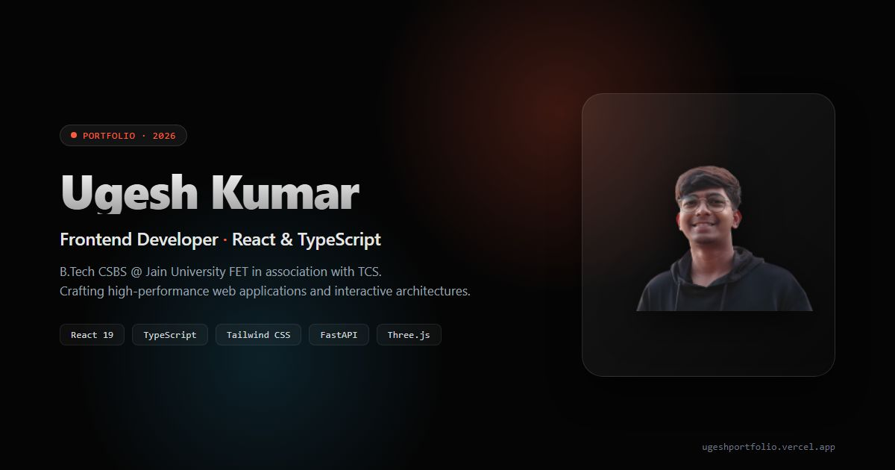

# Ugesh Kumar — Frontend Developer Portfolio

> **Live Production:** [ugeshportfolio.vercel.app](https://ugeshportfolio.vercel.app/)  
> **Target Roles:** Frontend Engineering Internships & Freelance Projects  
> **Tech Stack:** React 19 · TypeScript · Tailwind CSS v4 · FastAPI · Three.js · GSAP · Vite 6  



[](LICENSE)
[](https://www.typescriptlang.org/)
[](https://react.dev/)
[](https://tailwindcss.com/)
[](https://vitejs.dev/)

---

## 📌 Repository Topics
`react` · `typescript` · `vite` · `gsap` · `webgl` · `portfolio` · `tailwindcss` · `threejs` · `fastapi`

---

## 👤 About Ugesh Kumar

Detail-oriented **Computer Science and Business Systems (CSBS)** student at **Jain University Faculty of Engineering and Technology (FET)** in association with **Tata Consultancy Services (TCS)** (Expected Graduation: April 2029, currently Semester 3).

- **Academic Standing:** SGPA **9.09** (Semester 1) · **9.24** (Semester 2)
- **Primary Focus:** High-performance frontend engineering, interactive web applications, and test-backed backend services.
- **Availability:** Open to frontend internships (Bengaluru & Remote) and freelance web projects.

---

## 🚀 Featured Engineering Projects

| Project | Stack | Key Highlights | Links |
|---|---|---|---|
| **[Job Search Momentum](https://momentum-job-tracker.vercel.app/)** | React, TypeScript, Three.js, PostgreSQL | AI job search tracker with Kanban board, 3D career graphics, and PostgreSQL backend. | [Demo](https://momentum-job-tracker.vercel.app/) · [GitHub](https://github.com/ugesh13/Job_Application_Tracker) |
| **[CiteCheck AI](https://citecheck-jet.vercel.app/)** | React, FastAPI, Python, SQLModel, Pytest | Evidence-first brand governance engine where AI suggests and humans decide. 117 automated pytest tests. | [Demo](https://citecheck-jet.vercel.app/) · [GitHub](https://github.com/ugesh13/CiteCheck_AI) |
| **MemGuard AI** | React, Python, Model Auditing, Tailwind | Fine-tuned model extraction probe simulator and data leakage defense dashboard built for AVISHKAR hackathon. | *(In Review / Private)* |
| **[ECG Arrhythmia Detection](https://github.com/ugesh13/ECG_ARRHYTHMIA_ANALYSIS)** | Python, Signal Processing, ML, Web UI | Biomedical signal preprocessing and ML classification pipeline presented to university faculty. | [GitHub](https://github.com/ugesh13/ECG_ARRHYTHMIA_ANALYSIS) |
| **[Student Performance & XAI](https://github.com/ugesh13/IEEE_Research_Web)** | Python, Machine Learning, Explainable AI | IEEE-style research studying student outcomes on the OULAD dataset using SHAP feature attribution. | [Research Repo](https://github.com/ugesh13/IEEE_Research_Web) |
| **SecureClass** *(In Development)* | Security, Academic Tech, React | Privacy-preserving digital classroom and academic assessment integrity engine. | [GitHub](https://github.com/ugesh13/SecureClass) |

---

## 📜 5 Certificates & Participations

### Course Credentials
1. **What Is Generative AI?** — LinkedIn Learning (Aug 2026)
2. **AI Fluency: Framework & Foundations** — Anthropic (Jan 2026)
3. **Coding Foundations** — SoloLearn (Jul 2025)

### Hackathon Participations
1. **SIH 2026, Internal Round, JAIN FET** — Smart India Hackathon 2026 Internal Round at JAIN Faculty of Engineering and Technology (FET).
2. **Certificate of Participation, AVISHKAR 2026 Alumni-Led Hackathon** — JAIN Faculty of Engineering & Technology (FET), Bengaluru (Oct 31 to Nov 1, 2026).

---

## 🛠️ Local Development & Build

```bash
# Clean install exact dependencies
npm ci

# Start local development server
npm run dev

# Run TypeScript compiler check
npx tsc -b

# Execute production build
npm run build

# Preview production build locally
npm run preview
```

---

## 📄 License

This project is open source and available under the [MIT License](LICENSE).
